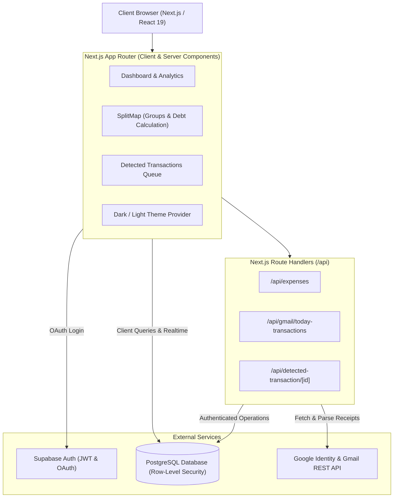

<div align="center">

# MoneyMap

### Smart Personal Expense Tracking • Group Bill Splitting • Automated Gmail Parsing

[](https://nextjs.org/)
[](https://react.dev/)
[](https://www.typescriptlang.org/)
[](https://supabase.com/)
[](https://tailwindcss.com/)
[](https://www.framer.com/motion/)

<p align="center">
  <b>Map your money, master your splits.</b><br>
  A modern, full-stack financial management platform designed to track personal expenditures, simplify group bill sharing (SplitMap), and automatically detect transactional receipts directly from your Gmail inbox.
</p>

[Key Features](#-key-features) •
[Architecture](#-system-architecture) •
[Tech Stack](#-tech-stack) •
[Project Structure](#-project-structure) •
[Getting Started](#-getting-started) •
[Database Schema](#-database-schema--rls) •
[Gmail Integration](#-gmail-api-integration)

---

</div>

## Overview

Managing personal budgets while coordinating shared expenses across roommates, friends, and trips is notoriously fragmented. **MoneyMap** unifies personal financial tracking and collaborative bill splitting into a single, high-performance web experience.

In addition to manual expense tracking and group debt balancing, MoneyMap features **automated transaction ingestion via Gmail**, reading digital transaction receipts (e.g., Swiggy, Zomato, Uber, Amazon) and queuing them for 1-click confirmation or dismissal.

---

## Key Features

### 1. Personal Expense Management
- **Instant Ledger Tracking:** Add, edit, categorize, and delete personal expenditures with tags, notes, and dates.
- **Dynamic Category Insights:** Automated categorization for groceries, utilities, entertainment, dining, travel, and more.
- **Recent Activity Feed:** Real-time transaction list with search, category filtering, and detailed inspection modal.

### 2. SplitMap (Group Shared Expenses)
- **Collaborative Groups:** Create groups for flats, trips, or projects, and invite members via email.
- **Smart Debt Calculation:** Automatically calculates optimal net balances ("who owes whom") across uneven or equal splits.
- **Settle Up System:** Log direct repayments between members and reconcile group debts with automated balance reduction.
- **Invitation Hub:** Real-time notifications for incoming group invitations with offline fallback storage.

### 3. Automated Gmail Transaction Detection
- **Smart Email Parsing:** Scans transaction confirmation emails via Google Identity Services and Gmail REST API.
- **Timezone-Normalized Extraction:** Computes dates in India Standard Time (IST / UTC+5:30) to eliminate midnight boundary classification errors.
- **Smart Category Inference:** Heuristic category prediction based on recognized merchant signatures.
- **Verification Queue:** Pending transactions can be edited, approved directly into your personal expense ledger, or dismissed.

### 4. Interactive Analytics & Visualizations
- **Monthly Spending Trends:** Visual expenditure breakdown over time using interactive bar and line charts powered by **Recharts**.
- **Category Distribution:** Dynamic Donut/Pie charts highlighting spending concentration.
- **Budget Health Metrics:** Real-time calculation of monthly burn rate and average daily spend.

### 5. Enterprise Security & Preferences
- **Supabase Authentication:** Secure sign-in via Email/Password or Google OAuth 2.0.
- **Row-Level Security (RLS):** Strict PostgreSQL policies ensure users can only access their own data or authorized group data.
- **Multi-Currency Preferences:** Seamlessly configure preferred currency symbols (`USD`, `INR`, `EUR`, `GBP`) across the app.
- **Dark & Light Mode:** Fluid theme switching with system default detection and Tailwind CSS v4 styling.

---

## System Architecture



---

## Tech Stack

| Domain | Technology | Description |
| :--- | :--- | :--- |
| **Framework** | [Next.js 16](https://nextjs.org/) | App Router, Server Components, and API Route Handlers |
| **UI Library** | [React 19](https://react.dev/) | Core component architecture |
| **Language** | [TypeScript 5](https://www.typescriptlang.org/) | End-to-end type safety |
| **Styling** | [Tailwind CSS v4](https://tailwindcss.com/) | Modern utility-first CSS engine |
| **Animations** | [Framer Motion](https://www.framer.com/motion/) | Smooth UI transitions and micro-interactions |
| **Data Visualization** | [Recharts](https://recharts.org/) | Responsive SVG charts (Pie, Bar, Area) |
| **Database & Auth** | [Supabase](https://supabase.com/) | Hosted PostgreSQL, Row-Level Security, and Auth |
| **External APIs** | [Gmail REST API](https://developers.google.com/gmail/api) | Parsing merchant receipts for automated tracking |

---

## Project Structure

```text
MoneyMap/
├── moneymap/                         # Main Next.js application
│   ├── app/
│   │   ├── (app)/                    # Authenticated application routes
│   │   │   ├── analytics/            # Spending analytics & charts
│   │   │   ├── dashboard/            # Central expense overview & quick actions
│   │   │   ├── groups/               # SplitMap group expenses & settlements
│   │   │   ├── settings/             # User profile & currency preferences
│   │   │   └── layout.tsx            # Authenticated app shell with sidebar
│   │   ├── api/                      # Backend API route handlers
│   │   │   ├── detected-transaction/ # Actions on detected receipts
│   │   │   ├── expenses/             # Expense creation & detected imports
│   │   │   ├── gmail/                # Gmail receipt scanner endpoint
│   │   │   ├── health/               # Health check endpoint
│   │   │   └── transactions/         # Recent transactions endpoint
│   │   ├── auth/                     # Supabase auth login & callback handlers
│   │   ├── components/               # Modular UI components & modals
│   │   ├── globals.css               # Global styles & theme tokens
│   │   └── page.tsx                  # Landing page with interactive hero
│   ├── data/                         # Static categories and color tokens
│   ├── lib/                          # Database clients and business logic helpers
│   │   ├── groupsDb.ts               # Group balance calculations & queries
│   │   ├── invitationsDb.ts          # Group invite management & fallbacks
│   │   ├── supabaseClient.ts         # Client-side Supabase client
│   │   ├── supabaseServer.ts         # Server-side auth verification helper
│   │   └── useUserCurrency.ts        # Currency state hook
│   ├── public/                       # Static icons and assets
│   ├── supabase/
│   │   └── schema.sql                # Complete SQL schema with RLS policies
│   ├── .env.example                  # Environment variable blueprint
│   ├── package.json                  # Dependencies and build scripts
│   └── tsconfig.json                 # TypeScript compiler configuration
├── .gitignore                        # Git ignore rules
└── README.md                         # Project documentation
```

---

## Getting Started

### Prerequisites

- **Node.js**: `v18.18+` or `v20+` recommended
- **Package Manager**: `npm`, `pnpm`, or `yarn`
- **Supabase Account**: For PostgreSQL database and authentication
- **Google Cloud Console Project**: For Google OAuth and Gmail API credentials

### 1. Clone the Repository

```bash
git clone https://github.com/Abbhiinay/MoneyMap.git
cd MoneyMap/moneymap
```

### 2. Install Dependencies

```bash
npm install
```

### 3. Configure Environment Variables

Create a `.env.local` file inside the `moneymap/` directory based on `.env.example`:

```bash
cp .env.example .env.local
```

Fill in your service credentials:

```env
# Supabase Configuration
NEXT_PUBLIC_SUPABASE_URL=https://your-project.supabase.co
NEXT_PUBLIC_SUPABASE_ANON_KEY=your-supabase-anon-key

# Google OAuth & Gmail API Credentials
NEXT_PUBLIC_GOOGLE_CLIENT_ID=your-google-client-id.apps.googleusercontent.com
GOOGLE_CLIENT_SECRET=your-google-client-secret
```

### 4. Setup Database Schema

1. Open your [Supabase Dashboard](https://supabase.com/dashboard).
2. Navigate to the **SQL Editor**.
3. Copy and run the script located at [`moneymap/supabase/schema.sql`](file:///C:/Users/ktony/Desktop/HTML/MoneyMap/moneymap/supabase/schema.sql).
4. This script sets up all required tables, foreign keys, performance indexes, and Row Level Security (RLS) policies.

### 5. Run the Development Server

```bash
npm run dev
```

Open [http://localhost:3000](http://localhost:3000) in your browser to view MoneyMap.

---

## Database Schema & RLS

The database is built on PostgreSQL via Supabase with full **Row-Level Security (RLS)** enabled across all tables:

| Table | Description | RLS Policy Summary |
| :--- | :--- | :--- |
| `expenses` | Personal transactions (amount, category, date, description) | Users can only select/insert/update/delete their own rows (`auth.uid() = user_id`). |
| `groups` | Expense splitting groups with JSONB member rosters | Accessible only by the group creator and listed group members. |
| `group_expenses` | Shared expenses assigned to a specific group with payer and split shares | Restricted to authenticated group members. |
| `group_settlements` | Repayment records between two group members | Restricted to authenticated group members. |
| `group_invitations` | Pending and resolved invitations to join groups | Visible to inviter and invited user's email. |
| `detected_transactions`| Transactions parsed from Gmail pending user approval | Restricted to the owning user (`auth.uid() = user_id`). |
| `profiles` | User preferences such as preferred currency (`USD`, `INR`, etc.) | Each user can view and edit only their own profile record. |

---

## Gmail API Integration

MoneyMap scans transaction emails securely using Google Identity Services (GIS):

1. **Authentication:** The client requests consent with the `https://www.googleapis.com/auth/gmail.readonly` scope.
2. **Scan Endpoint:** [`/api/gmail/today-transactions`](file:///C:/Users/ktony/Desktop/HTML/MoneyMap/moneymap/app/api/gmail/today-transactions/route.ts) queries messages received during the current day (IST adjusted).
3. **Regex & Heuristics:** The parser identifies debit notices, merchant names, amounts, and transaction dates.
4. **Staging:** Extracted items are inserted into `detected_transactions` with status `'detected'`.
5. **Confirmation:** Users review detected items on their Dashboard to approve them into `expenses` or dismiss them.

---

## Deployment

The easiest way to deploy MoneyMap is via **Vercel**:

1. Push your repository to GitHub.
2. Import the project into [Vercel](https://vercel.com/new).
3. Set the **Root Directory** to `moneymap`.
4. Add all environment variables from `.env.local` to the Vercel Project Settings.
5. In your Google Cloud Console and Supabase Auth settings, add your production domain to authorized redirect URIs.
6. Click **Deploy**.

---

## License

This project is licensed under the [MIT License](LICENSE).